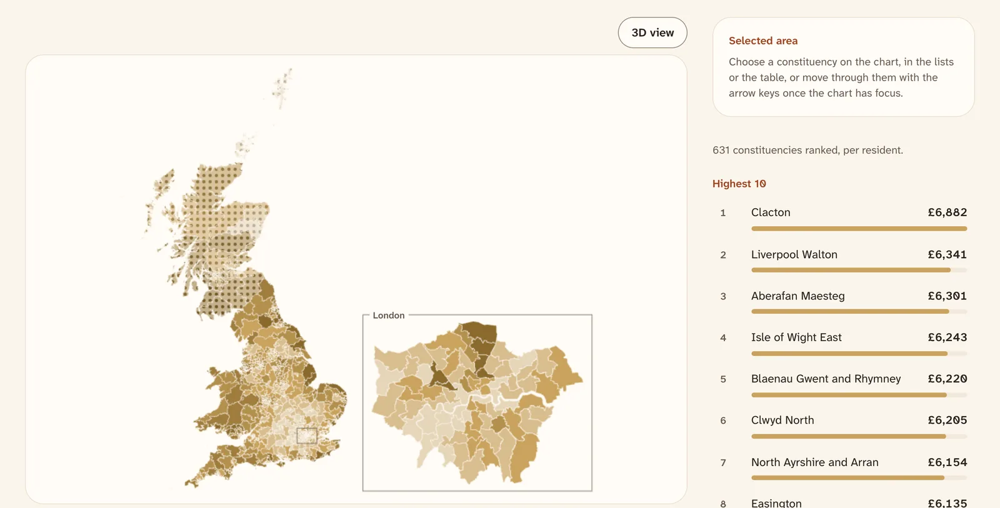

<p align="center">
  <picture>
    <source media="(prefers-color-scheme: dark)" srcset="docs/images/explore-dark.webp">
    
  </picture>
</p>

# Who Gets What

Benefit spending and the number of people claiming, for every constituency
and council in Great Britain, at [whogetswhat.uk](https://whogetswhat.uk).

```sh
mise install && pnpm install --frozen-lockfile
pnpm run data:pull
pnpm run dev --host 127.0.0.1 --strictPort
```

Then open <http://127.0.0.1:3000>. You need [mise](https://mise.jdx.dev).
`data:pull` downloads the pinned data release from this repository, with no
account.

## What it shows

- A short narrated film on the home page: who received £299 billion of
  benefits in 2024-25, and where they live.
- A map of all 632 constituencies and 350 local authorities, with London drawn
  again in an inset. It also switches to equal-size hexagons, a dot chart and
  a ranked list.
- A page for each area, side-by-side comparisons, and rankings on every
  measure, in total and per person.
- Every table as CSV and Parquet on [/data](https://whogetswhat.uk/data), with
  checksums and licences.

## How the figures stay fair

Every figure says who it counts, which prices it uses and where it comes
from. Pensioner benefits are divided by people aged 66 and over, and
working-age benefits by people aged 16 to 64. Money is adjusted for inflation
by default. Tests check every page and the film's narration for loaded words.
The full rules are in [ADR 0004](docs/adr/0004-neutrality-and-honesty-rules.md).

The site covers Great Britain. Benefits in Northern Ireland are run by the
Department for Communities and are not in these sources.

## How it works

A Python [pipeline](pipeline/README.md) fetches DWP, Social Security
Scotland, ONS, HMRC and Parliament data, builds one model in DuckDB, and
publishes each compile as a GitHub Release. The site is TanStack Start on
Cloudflare Workers. It prerenders about 2,000 pages from the release that
`data.lock.json` pins, and draws the map with deck.gl.

- [Architecture](docs/architecture.md)
- [Decisions](docs/adr/README.md)
- [How each measure is computed](docs/methods/)
- [The film](docs/film/engineering.md) and [its sound](docs/film/audio.md)
- [Commands and checks](AGENTS.md)

## Contributing

Issues and pull requests are welcome, especially corrections to figures. See
[CONTRIBUTING.md](CONTRIBUTING.md).

## Licence

The code is MIT. The data keeps its sources' licences, mainly the Open
Government Licence v3.0. The film's audio and the name and marks are not
covered by the MIT licence. See [LICENSE](LICENSE) and
[credits](docs/credits.md).

Made by Connor Adams ([@connorads](https://x.com/connorads)).
