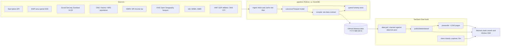
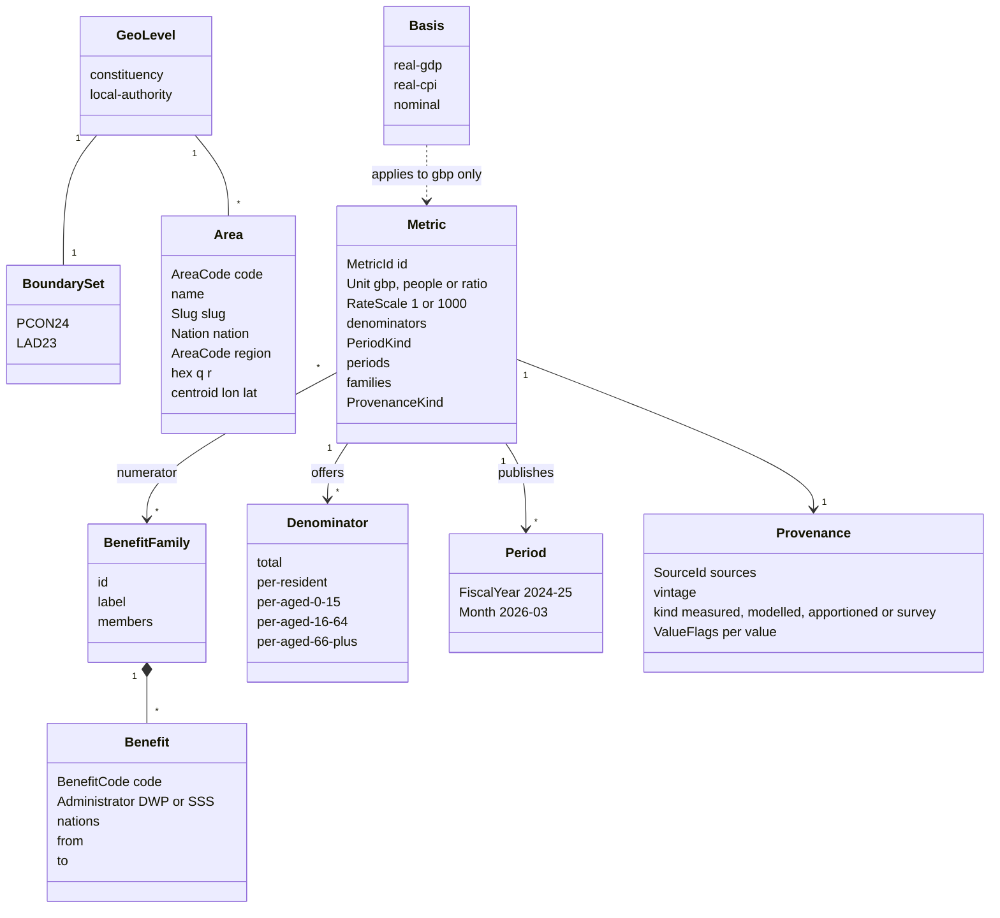
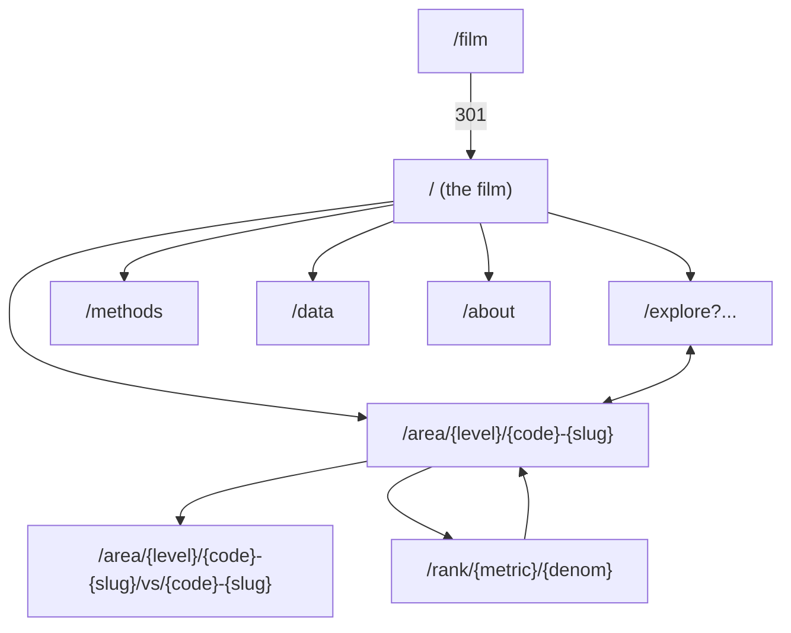
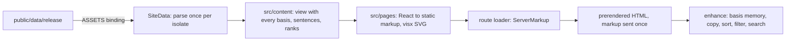
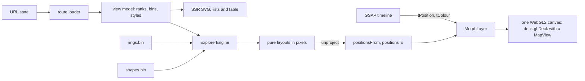

# Architecture

Who Gets What publishes UK benefit spending and caseloads by area as a
static, prerendered site with client-side explorer islands. This document is
the standing design. Decisions and their rejected options are in
[docs/adr](adr/README.md).

## Scope

- **Geography.** Great Britain. 632 Westminster constituencies on 2024
  boundaries (`PCON24`) and 350 local authorities on April 2023 boundaries
  (`LAD23`). Northern Ireland is out of scope and labelled as not covered.
- **Time.** Fiscal years from 2010-11 for spending. Monthly or quarterly
  snapshots for caseloads, latest first, history where Stat-Xplore has it.
- **Scotland.** Social Security Scotland benefits merge into GB benefit
  families ([ADR 0004](adr/0004-neutrality-and-honesty-rules.md)).

## System overview



1. **Ingest** fetches each source into a raw cache, keyed by URL and retrieval
   date. Stat-Xplore needs `STAT_XPLORE_API_KEY`.
2. **Canonical** builds dimension and fact tables in DuckDB and writes them as
   Parquet. It applies the rules in
   [pipeline/README.md](../pipeline/README.md): rebuilt totals, matched fiscal
   years, boundary filters and Scottish harmonisation.
3. **Compile** turns the canonical tables into the [data contract](#data-contract).
4. **Release** packs the contract and the canonical Parquet as GitHub Release
   assets ([ADR 0002](adr/0002-github-releases-as-the-v1-data-store.md)).
5. **Build** pulls the release pinned in `data.lock.json` into
   `public/data/{release}/`, then prerenders pages from it
   ([ADR 0001](adr/0001-static-compiled-data-over-a-runtime-database.md)).

### Commands

Every entry point is a pnpm script
([ADR 0005](adr/0005-python-pipeline-with-pnpm-entry-points.md)).

| Script | Runs | Needs |
| --- | --- | --- |
| `data:ingest` | `uv run --project pipeline wgw-pipeline ingest` | network, `STAT_XPLORE_API_KEY` |
| `data:compile` | `uv run --project pipeline wgw-pipeline compile` | raw cache |
| `data:test` | `uv run --project pipeline pytest` | compiled output |
| `data:release` | `uv run --project pipeline wgw-pipeline release` packs and writes `data.lock.json`; `--publish` creates the GitHub Release | `gh` auth for `--publish`; the maintainer runs it |
| `data:pull` | HTTPS download of the release asset, hash check, extract, then remove every other release from `public/data/` | network, `data.lock.json` |

`data:pull -- --local` copies `pipeline/build/site/{release}/` instead, so a
compiled release can be tried in the app before it is published.

### Repository layout

```text
contract/schema/       JSON Schemas generated from src/domain (pnpm run test -u)
contract/fixtures/     synthetic fixtures both test suites read
contract/neutrality/   banned-word list both test suites read, and the style-word list
docs/film/             the film's engineering and its audio build
docs/methods/          how each derived measure is computed
e2e/                   Playwright specs; @perf specs run with pnpm run perf:explore
pipeline/              Python package: src/wgw_pipeline, tests, build/ (ignored)
public/audio/          the film's narration, cues, score, caption timings and manifest (audio:build)
public/brand/          wordmark, monogram, halftone reference and their notes
public/data/           pulled data release (ignored)
scripts/audio/         audio:build: ElevenLabs requests, cache, ffmpeg mastering, manifest
scripts/data-pull.ts   data:pull, checked against the release manifest
scripts/pages.ts       the pages the build prerenders, from the pulled release
scripts/og.ts          share cards (Takumi), run by pnpm run build
scripts/prerender-check.ts   prerender:check: pages written, share cards, asset count, banned and style-list words, old name
src/components/        app shell; ui/ is vendored shadcn/ui
src/content/           page views: figures in every basis, templated sentences, ranks, comparisons
src/data/              the DataSource port, its fetch and ASSETS adapters, parsed release reads, a disk source for tests
src/design/            token readers and contrast maths for tests
src/domain/            domain types, data contract, URL-state codec, banned-word check
src/explore/           /explore: loader, view model, controls, SVG fallback, tables, heroes
src/film/              /: script, figures, timeline, grains worker, controller, player, stills, audio
src/lib/               site constants, preferences, formatting, head tags, page enhancers
src/pages/             server-rendered page markup (ADR 0007)
src/routes/            TanStack file routes, including the noindex /styleguide
src/server.ts          Worker entry: registers the ASSETS DataSource
src/server/pages.ts    server functions that render data pages
src/styles.css         design tokens and Tailwind theme; data-pages.css for data pages
src/viz/               pure layouts and colour bins; engine/ is the deck.gl island; svg/ the server-rendered visx charts
data.lock.json         the release the site builds against
```

## Domain model

`src/domain/` is the shared kernel. The app, the tests and any future MCP
server import it; it imports nothing from the app. Values cross every
boundary through its parsers, so branded types such as `AreaCode` and
`FiscalYear` exist only after a check.



| Concept | Module | Notes |
| --- | --- | --- |
| `GeoLevel`, `BoundarySet`, `Nation`, `AreaCode`, `Slug` | `geography.ts` | A code is valid only for its level's GSS entity codes. |
| `BenefitFamily`, `BenefitCode`, `Administrator` | `benefit.ts` | Families pair DWP benefits with their Scottish replacements. |
| `MetricId`, `Unit`, `Denominator`, `RateScale`, `Basis`, `ProvenanceKind`, `ValueFlag` | `measure.ts` | `applyBasis` and `denominatorLabel` live here. |
| `FiscalYear`, `Month`, `PeriodKind`, `MidYear` | `period.ts` | `2010-11` is both a fiscal year and a month, so periods always travel with their kind. |
| Data contract schemas and paths | `contract.ts` | Structural zod schemas plus `parse*` cross-field checks. |
| Binary bundles | `bundle.ts` | `parseBundle` returns zero-copy typed arrays. |
| URL state | `url-state.ts` | One codec for explorer search params, rank paths and MCP inputs. |
| Change decomposition | `decomposition.ts` | `decompose` turns published inputs into population, claim-rate and award-size effects for a basis. |
| Ranks | `rank.ts` | The pipeline's rank rule for the explorer and rank pages: highest first, ties shared, `UNRANKED` flags left out. |

Expected failures are values (`Result` in `result.ts`). A missing price factor
or an empty catalogue is a defect and throws.

### Benefit families

| Family | DWP | Social Security Scotland |
| --- | --- | --- |
| `state-pension` | State Pension | |
| `pension-credit` | Pension Credit | |
| `attendance-allowance` | Attendance Allowance | Pension Age Disability Payment |
| `winter-fuel` | Winter Fuel Payment | Pension Age Winter Heating Payment |
| `personal-independence` | Personal Independence Payment | Adult Disability Payment |
| `disability-living` | Disability Living Allowance | Child Disability Payment |
| `carers` | Carer's Allowance | Carer Support Payment |
| `universal-credit` | Universal Credit | |
| `housing-benefit` | Housing Benefit | |
| `employment-support` | Employment and Support Allowance | |
| `jobseekers` | Jobseeker's Allowance | |
| `income-support` | Income Support | |
| `other` | Bereavement, Incapacity Benefit, Severe Disablement Allowance | |

Each member carries `from` and `to` fiscal years, so a family switches source
for Scotland in the year the replacement took over.

### Value flags

Every value in a bundle or dossier carries one byte of flags.

| Bit | Flag | Meaning |
| --- | --- | --- |
| 0 | `apportioned` | Allocated from a larger geography by population share |
| 1 | `modelled` | Estimated, for example caseload x mean award run rate |
| 2 | `survey` | Sample-based, for example HMRC SPI income tax |
| 3 | `suppressed` | Withheld at source; the value is null or NaN |
| 4 | `partialCoverage` | Some component benefits are missing for this period |
| 5 | `harmonised` | Includes a Social Security Scotland benefit in its family |
| 6 | `smallPopulation` | Denominator band under 1,000 people; not ranked |
| 7 | `seriesBreak` | Boundary or method change at this period |

A value with none of bits 0 to 2 is measured.

## Data contract

The pipeline writes, and the app reads, exactly these files. `src/domain/contract.ts`
and `src/domain/bundle.ts` define them; `contract/schema/` holds the generated
JSON Schemas the pipeline validates against.

```text
/data/{release}/
  manifest.json                          release id, hashes, coverage
  meta/catalogue.json                    metrics, benefit families, price factors, sources, caveats
  meta/areas-{level}.json                ordered areas: the area order for every bundle
  meta/gb-{level}.json                   GB value and ranked-area count per metric, denominator and period
  area/{level}/{code}.json               one dossier per area (982 files)
  series/{level}/{metric}/{denom}.bin    TADB series bundle
  layout/{level}/swarm/{metric}/{denom}.bin   TADB beeswarm layout, all periods
  layout/{level}/rings.bin               TADB polygon rings for morphs
  layout/{level}/shapes.bin              TADB every polygon, triangulated, for the map
  layout/{level}/map.svg                 SVG sprite of every area, for server-rendered maps
  decomposition/{level}/{family}.bin     TADB change decomposition inputs per area
  geo/{level}.geojson                    generalised boundaries; feature property `i` = area index
  downloads/{table}.parquet              canonical tables for /data
  downloads/{table}.csv                  the same tables as CSV
  downloads/fact_spend_area-{level}-{fiscalYear}.csv   spending CSV, split to stay under 10 MB
  downloads/all-tables.zip               every CSV and Parquet file above, reproducible zip
```

`{level}` is `constituency` or `local-authority`. `dataPath` in
`contract.ts` builds every path, so no other code formats one.

### Versioning

- A release id is `YYYY-MM-DD.N`. It names the GitHub tag `data-{release}`
  and the URL prefix, so data URLs are immutable. `/data/*` is served with
  `Cache-Control: public, max-age=31536000, immutable`.
- `manifest.json` lists every other file with its byte length and SHA-256.
  `data:pull` verifies the site asset against `data.lock.json`; the build
  verifies the extracted files against the manifest.
- `schemaVersion` is 2 in every JSON file, and the bundle format version is 1.
  A breaking change bumps the version and ships parser and pipeline together.

### JSON files

All JSON objects are strict: an unknown key fails parsing, so a renamed field
cannot disappear silently. Money is nominal pounds in every file; the app
applies the reader's basis with `applyBasis`.

- **`manifest.json`**: `release`, `createdAt`, `pipelineCommit`, `priceBase`,
  `levels` (boundary set, area count and area order hash per level),
  `coverage` (nations covered and what is not), `files`.
- **`meta/catalogue.json`**: `priceBase`, `defaultMetric`, `metrics`
  (definition per metric: unit, rate scale, levels, denominators and default,
  period kind and ascending periods, benefit families, provenance, sources,
  caveats, nations covered per period), `families` (members with
  administrator, nations and years), `fiscalYears` (outturn or forecast, and
  `realGdp` and `realCpi` multipliers to `priceBase` prices), `sources`
  (publisher, title, URL, publication date, licence), `caveats`, `models`
  (area profile inputs with label, period and sources, and the [modelled
  spending](methods/expected-spending.md) fits with every coefficient, and how
  neighbours are chosen), `conditions` (the month, sources and PIP condition
  groups, largest first, with claimants and share in England and Wales) and
  `decomposition` (method text, and per family the benefit counted, claimant
  unit, eligible band, `from` and `to` months, population periods, nations
  covered and GB inputs per level).
- **`meta/areas-{level}.json`**: `areaOrderHash`, `populationPeriod`,
  `hexLayout: "odd-r"`, `bounds` (the extent of every area's map shapes,
  islands included, as `[[west, south], [east, north]]`), `regions` (each
  with its own `bounds`), and `areas` sorted ascending by code. Each
  area has `code`, `name`, `slug`, `nation`, `region`, `hex {q, r}`,
  `centroid [lon, lat]` and `population`.
- **`area/{level}/{code}.json`** (the dossier): `area`, `overlaps` (areas of
  the other level that share residents, with population share), `population`
  by age band, `facts` (latest value, flags and GB rank per metric and
  denominator), `spendByFamily` for the latest fiscal year, `series` for
  sparklines, `decomposition` (inputs per family the area has, see
  [methods](methods/decomposition.md)), `expected` (actual, modelled and
  residual spending per fit, with any missing input), `neighbours` (the 15
  [statistical neighbours](methods/statistical-neighbours.md) with distance),
  `deprivation` (within-nation decile
  and source), `representation` (constituencies only: member, party as text,
  since), `election` (constituencies only: the 4 July 2024 result with every
  candidate's party as text, votes and share, the majority and turnout),
  `conditions` (PIP claimants per catalogue condition group with flags; null
  for Scottish areas, whose caveat says why) and `caveats`.
  `facts` has one entry per metric and `series` one per sparkline, each as
  parallel arrays (`denominators` or `periods` with `values` and `flags`), so a
  council's 15 years of 27 metrics stay under 20 kB. `factRows` and
  `seriesPoints` in `contract.ts` read them back as rows; `factRows` joins
  each fact to its GB value and ranked-area count.
- **`meta/gb-{level}.json`**: per metric and denominator, parallel arrays over
  `periods` of the GB value (the GB numerator over the GB band, not a mean of
  areas) and `rankOf`, the number of areas ranked. Every area shares them, so
  dossiers do not repeat them. The GB numerator and band are both summed over
  councils, so both files hold the same GB value for a metric, denominator
  and period; only `rankOf` differs by level.

The area order hash is the first 16 hex characters of SHA-256 over the codes in
published order, joined by `\n`. Codes sort ascending, so the order changes
only when a boundary set changes.

### Binary bundles (TADB)

Bundles hold one number per area, in area order, so the explorer can hand them
to the GPU without per-row objects.

```text
offset  size  field
0       4     magic "TADB"
4       2     format version, u16 LE (1)
6       2     reserved, 0
8       4     header length H, u32 LE
12      H     header: UTF-8 JSON
...           sections in header order, each starting at the next multiple of 4
```

The file ends exactly where the last section ends. All numbers are
little-endian. The header names its `kind`, `release`, `level`, `areaCount`,
`areaOrderHash` and `sections` (`name`, `dtype` `f32`, `u8`, `u16` or
`u32`, `length`).

| Kind | Header adds | Sections |
| --- | --- | --- |
| `series` | `metric`, `denominator`, `unit`, `rateScale`, `periodKind`, `periods` | `values` f32 and `flags` u8, periods x areas, period-major; NaN means no value |
| `swarm` | `metric`, `denominator`, `periodKind`, `periods`, `scale` (`linear` or `log`), `domains` per period, `radius` | `xy` f32, periods x areas x 2; x from 0 to 1 across the domain, y in the same units |
| `rings` | `pointsPerRing` | `lonLat` f32, areas x points x 2; largest ring, equal arc length, from the northernmost point, clockwise |
| `shapes` | `bounds` | `xy` u16, vertices x 2, in 1/65535 steps across `bounds`; `rings`, `polygons` and `areas` u32 start offsets, each with a final end entry; `triangles` u16, three per triangle from the polygon's first vertex; `polygonTriangles` u32 offsets. Outer rings run counter-clockwise, holes clockwise |
| `decomposition` | `family`, `from`, `to` | `population`, `claimants` and `meanWeeklyAward` f32, each 2 x areas, `from` then `to`; `flags` u8, one per area; NaN means not every input |

Value index for period `p` and area `i` is `p * areaCount + i`, so one period
is a contiguous slice (`periodSlice`). `contract/fixtures/series-mini.bin.hex`
is the golden encoding both languages test against.

### Map sprite

`layout/{level}/map.svg` holds one `<path id="a{index}">` per area, in area
order, with every polygon and hole (`fill-rule="evenodd"`). Coordinates are
Web Mercator world pixels at zoom 7 (512-pixel tiles, as deck.gl's
`MapView`), measured from the north-west corner of the level's `bounds`, at
one decimal. Server-rendered maps draw each area with an SVG `<use>` of its
path, so the page carries no coordinates.

### Size budget

| Item | Count | Each |
| --- | --- | --- |
| Dossiers | 982 | 8 to 20 kB |
| Series bundles | about 120 | 20 to 60 kB |
| Swarm layouts | about 120 | 40 to 80 kB |
| Decomposition bundles | 20 | up to 60 kB |
| Rings, shapes, sprites and boundaries | 8 | up to 1 MB |
| Metadata | 6 | up to 2 MB |
| Downloads | about 50 | up to 10 MB |
| Archive of every download | 1 | up to 25 MiB, the Workers asset limit |

The release must stay under 2,000 files and 150 MB, inside the Workers limits
of 20,000 files and 25 MiB per file.

Boundaries are simplified per area: the tolerance is 3% of the square root of
the area's size, between about 55 m and 890 m, so small urban areas keep their
shape. Neighbouring areas can then disagree by up to the larger tolerance
along a shared edge.

## Routes



| Route | Content | Rendering |
| --- | --- | --- |
| `/` | "Where benefit money goes": a narrated film in seven chapters that plays like a video, with captions, a transcript and a Read mode | Worker SSR on every request: poster, stills and words as HTML; the film chunk loads when the browser is idle |
| `/explore` | One canvas: map (with a London inset), equal-size areas, swarm and rank views, with lists, heroes and a table of every area | Worker SSR of the requested state as SVG (the map from the release's sprite), lists and the table's first 50 rows; client island renders the rest of the table on request and Explained by age's dots in view |
| `/area` | Every area by region, a name filter and a postcode lookup (postcodes.io, in the browser) | Prerendered |
| `/area/{level}/{code}-{slug}` | Dossier: comparison sentences, headline figures with ranks, spend by family, trends, modelled level, income tax only, deprivation, neighbours, overlaps, every figure with provenance, caveats, sources | Prerendered, 982 pages; a wrong slug redirects to the canonical one |
| `/area/{level}/{a}/vs/{b}` | Side-by-side comparison, same level only, with the denominator switch | Worker SSR on demand |
| `/embed/area/{level}/{code}?chart=` | One dossier chart with its table and source, for iframes | Prerendered, 982 pages, noindex; a head script picks the chart |
| `/rank` | Every ranking by group | Prerendered |
| `/rank/{metric}/{denom}` | League table for one metric and denominator | Prerendered, 66 pages; each holds both levels and `?level=local-authority` selects the council table |
| `/film` | Redirects to `/` with its parameters | 301 from the Worker |
| `/methods` | Sources, rules, reconciliation, ADR 0004 in plain words | Prerendered |
| `/data` | The release: every table as CSV and Parquet from this site, column dictionary, sizes, SHA-256 checksums, licence and credit | Prerendered |
| `/about` | Publisher disclosure | Prerendered |

The film is the home page. Its canvas chunk loads when the browser is idle,
so a reader who skips to the explorer or an area page never waits for it.

Every page reads release data through one port, `DataSource`
(`src/data/source.ts`), with `json(path)` and `bytes(path)`; a missing file
comes back as a `data-missing` value. Server functions in
`src/server/pages.ts` read the Workers `ASSETS` binding, at prerender and on
demand. The explorer loader runs in both runtimes: `dataSource()` is `fetch`
in the browser and, on the server, the `ASSETS` source that `src/server.ts`
registers. Tests read the pulled release from disk.

### Page rendering

Data pages render to static markup on the server and hydrate only the shell
([ADR 0007](adr/0007-render-data-pages-to-static-markup.md)). The pipeline
from data to page:



- Money is carried in all three bases; three radios and `:has()` show the
  reader's choice, and `enhance` remembers it in `localStorage`.
- Every chart sits beside a table with the same numbers. Derived values carry
  a dot screen in charts and a provenance chip in tables.
- Links inside the markup are plain anchors. A move between data pages loads
  a static file, with cross-document view transitions where supported.
- "Download" buttons on the explorer and area pages build CSV in the
  browser (`src/content/csv.ts`): the explorer from its loaded numbers,
  an area page from its release files on first click, so neither needs a
  server route. The footer links the source repository.
- The build lists pages from the pulled release (`scripts/pages.ts`) and does
  not crawl links, so compare pages stay on demand.
- `pnpm run build` then renders a share card per area and ranking
  (`scripts/og.ts`, Takumi in Node) and writes `robots.txt`; the prerender
  writes `sitemap.xml`. `VITE_SITE_ORIGIN` sets the origin for canonical
  links, cards, embed code and the sitemap. `.env.production` holds the
  deployed origin and the environment overrides it; without either the
  build warns and uses the reserved `who-gets-what.example`.

### URL-state grammar

`src/domain/url-state.ts` owns it.

```text
/explore?level=&metric=&denom=&basis=&period=&view=&sel=&vs=
```

| Key | Values | Default |
| --- | --- | --- |
| `level` | `constituency`, `local-authority` | `constituency` |
| `metric` | a `MetricId` the level publishes | `defaultMetric` |
| `denom` | a denominator the metric offers | the metric's default |
| `basis` | `real-gdp`, `real-cpi`, `nominal` | `real-gdp` |
| `period` | a period the metric publishes | the latest |
| `view` | `map`, `hex` (equal-size areas, constituencies only), `swarm`, `rank` | `map` |
| `sel` | an `AreaCode` of the level | none |
| `vs` | an `AreaCode` of the level; needs `sel` | none |

- `decodeExploreQuery` reads raw params and drops malformed fields.
  `resolveExploreState` fills defaults from the catalogue and drops values the
  metric does not publish. Both report each dropped field as an issue.
- `encodeExploreState` omits defaults and writes keys in table order, so each
  state has one canonical URL.
- TanStack Router `validateSearch` calls the decoder. The explore loader
  depends on every field but `view`, which needs no data, so a view change
  does not re-run it. A future MCP tool takes `ExploreQuery` as its input
  schema and returns the canonical URL.

## Visualisation engine

[ADR 0003](adr/0003-one-deckgl-canvas-and-one-gsap-clock.md) and
[ADR 0008](adr/0008-draw-the-explorer-with-deckgl-alone.md) set the stack. The engine is a client-only island in `src/viz/engine/`, loaded with
`React.lazy` when the browser is first idle after the server-rendered SVG has
painted; the server build leaves it out.



- **One mark per area.** `MorphLayer` (`morph-layer.ts`) is a deck.gl layer
  that draws every area as one ring of `pointsPerRing` vertices, in area
  order. Areas with no value stay on the canvas, hatched; nothing is removed.
- **Layouts are pure functions** in `src/viz/layout/` from bundles and the
  canvas size to rings in CSS pixels: hex from `hex {q, r}`, swarm from the
  swarm bundle (areas with no value sit in a tray), rank as bars from sorted
  values (rectangles with their corners as ring vertices, so every bar has
  square ends and starts at zero), and the map from `rings.bin`. They run on the main thread: a full
  layout of 632 areas takes a few milliseconds.
- **The map and its inset** ([ADR 0009](adr/0009-real-map-by-default-with-a-london-inset.md)).
  `mapFrame` (`src/viz/layout/map-frame.ts`) fits the level's `bounds` and
  places the London inset beside Great Britain on a wide stage, or over open
  sea on a narrow one. On a phone it shrinks Great Britain a little, to as
  little as 80% of the stage, until the inset is a third of the stage wide.
  The server's SVG uses the same function. At rest the
  map draws every area's real shapes from `shapes.bin`, faded in over the
  rings once they land, with hairlines and hit tests on the same shapes, and
  London's shapes again in the inset. The shapes leave as soon as marks move.
- **Hex layouts** (the "Equal-size areas" view, constituencies only) come from Open Innovations' hexjson files in
  [odileeds/hexmaps](https://github.com/odileeds/hexmaps) (MIT):
  `uk-constituencies-2023.hexjson`, identical to the 2024 constituency layout
  in `open-innovations/constituencies`, and
  `uk-local-authority-districts-2023.hexjson`. Both are `odd-r` and include
  Northern Ireland, which the pipeline drops. The site credits Open
  Innovations.
- **One coordinate space.** The camera fits the level's bounds once per
  canvas size and never moves between views, except to tilt and pull back
  for the skyline. Pixel layouts are unprojected to longitude
  and latitude with the same Web Mercator maths as deck.gl's `MapView`, so
  circles stay round and the map view needs no conversion.
- **Morphs.** The vertex shader mixes `positionsFrom` and `positionsTo` by
  `tPosition`, and colours by `tColour`. A change sets the from buffers to the
  marks' current positions, so an interrupted morph retargets smoothly. Every
  ring starts at its top and runs clockwise, and all rings share one
  triangulation cut from the boundaries, which stays valid for the convex hex,
  circle and bar shapes.
- **One clock.** GSAP owns `tPosition`, `tColour`, the camera and the DOM
  tweens; Four rulers schedules its steps with `gsap.delayedCall`. deck.gl
  `transitions` are not used.
- **Staging.** Positions, then colour; axes fade out before and back in after
  a step. A view change takes 600 ms, a denominator change 800 ms. Durations
  are constant and no ease overshoots. Fiscal years snap.
- **Picking.** Hit tests run on the CPU against the target rings, so the
  canvas needs no picking pass and keyboard focus uses the same anchors.
- **Reduced motion.** The app's motion preference (the operating system
  setting or the visible toggle) turns every morph into a cross-fade of
  120 ms, runs Four rulers at once and disables the 3D view. The numbers
  are the same.
- **Skyline.** "3D view" extrudes every real shape, the inset's too,
  with deck.gl's `SolidPolygonLayer` over the pipeline's triangles, to the
  measure on screen from zero, then tilts the camera; "Flat view"
  settles it. A key gives the height scale and says that large areas look
  biggest in 3D. Measures with values below zero cannot rise.
- **Islands.** `rings.bin` holds each area's largest part, which is the
  ring that morphs. `shapes.bin`, read with it before the canvas first
  draws, holds every part (Orkney, Shetland, the Western Isles, Anglesey and
  other islands and exclaves) and every hole, with the pipeline's
  triangles. It is about 260 kB gzip for constituencies, read once per level
  and never on a view change.
- **Basemap.** No tiles and no third-party style: deck.gl draws on a
  transparent canvas over the paper background, and the map view at rest
  adds boundary hairlines from `shapes.bin`. The canvas has no controller and
  lets touch scrolling through to the page.

## Film

The film is the home page and plays like a video
([ADR 0010](adr/0010-the-film-is-the-home-page-and-plays-like-a-video.md)).
It uses the explorer's stack: one deck.gl canvas with no basemap library
([ADR 0008](adr/0008-draw-the-explorer-with-deckgl-alone.md)) and one GSAP
timeline ([ADR 0003](adr/0003-one-deckgl-canvas-and-one-gsap-clock.md)).
[docs/film/engineering.md](film/engineering.md) has the detail and the
measurements; [docs/film/audio.md](film/audio.md) covers the sound.

- **One number.** One timeline's progress runs from 0 to 1. The player sets
  it while the film plays; the reader's scroll scrubs it otherwise. `frameAt` is a pure function of it, so a frame is the same
  scrolling down or up, and `?frame=<t>` pins any frame for screenshots.
- **Chapters are scenes.** Each chapter owns a span of progress sized by its
  scroll length and ends on a rest frame that holds still. Hash links land
  on rest frames.
- **Words.** `src/film/script.json` holds every narrated word, and a test
  checks each narrated figure against the pinned release. Scroll-driven
  captions start each beat with the scene it describes (`BEAT_STARTS`).
- **Playback.** Play runs the film like a video: the narration's audio clock
  maps to progress through the same knots, run the other way, so the voice,
  the caption and the frame agree. It waits at the guess. The reader's own
  scroll takes over and Resume plays on from the beat on screen.
- **Shape.** The rain lands on the real map by default, and the shape switch
  gives each constituency the same space instead. The two skylines extrude
  each area's ring of that shape.
- **Grains.** A web worker bakes the grain scenes in the browser from series
  the release already publishes, so the data contract has no grain bundle.
  The grain size (£1m or £10m) depends on the device.
- **Modes.** Watch needs WebGL2. Read mode (`?mode=read`, reduced motion, no
  WebGL2 or no JavaScript) shows the server-rendered stills and words.
- **Hand-off.** A postcode lands the camera on the reader's constituency;
  the film then flies home and opens `/explore?view=map&sel=<code>` with a
  view transition. The two pages do not share a canvas.
- **Sound.** Nothing plays until the reader presses Play. `public/audio/manifest.json`
  lists every file in Opus and AAC; a test checks it against the script.

## Testing

| Layer | Tool | What it proves |
| --- | --- | --- |
| Pipeline honesty | pytest | Rebuilt totals; seats plus abroad equal GB per benefit; ratios pair the same fiscal year; no DWP and SSS double count; Scottish apportioned values flagged; price base factors are 1; small populations unranked; no published TOTAL rows used |
| Contract conformance | pytest + `contract/schema` | Every compiled JSON file validates; bundle sections match the golden fixture bytes |
| Domain | Vitest | Codec round-trips for every coherent state; contract parsers accept fixtures and reject each violation; bundle errors; basis maths |
| Copy and charts | Vitest | Banned words absent from templates and prerendered pages; every chart names its denominator, basis and source; waterfalls sum; slopegraphs share one scale |
| Page views and markup | Vitest | Ranks match every dossier; every area's sentences and figures use no banned word; English, Welsh and Scottish dossiers, a comparison, a ranking, an embed and the text pages render with one heading and a table beside every chart |
| Build output | `pnpm run prerender:check` | Every listed page written with its share card; under 20,000 static assets; no banned word in any prerendered page |
| Pages | Playwright (`pnpm run test:e2e`) | Smoke on the built Worker: area pages in three nations, basis switch, redirects, comparison, ranking filters, methods, embed, 404. `/explore` renders SVG, lists and the table's first 50 rows on the server, links readers without JavaScript to the league table and shows every row on request; a denominator change updates the URL, canvas and top ten; a keyboard reader steps through areas, hears each rank and selects one. The film at `/` sends Read mode without JavaScript, draws Watch mode, plays and scrolls itself, waits for the guess, hands over to a wheel scroll and resumes, pauses on Space and steps by arrow, steps through stills with reduced motion, falls back to Read without WebGL, greets a returning viewer, keeps a keyboard guess on the device, lands chapter links ready to resume, and `/film` redirects to it |

## Budgets

### Performance

| Surface | Budget |
| --- | --- |
| Area, rank and text pages | LCP 2.0 s or less on a mid-range phone over slow 4G; JS 120 kB gzip or less; no WebGL |
| Explorer | First paint from SSR SVG and table; HTML 60 kB gzip or less; engine chunk 450 kB gzip or less, loaded after first paint; 60 kB or less of data per view change |
| Motion | Morphs at 55 fps or more at p75 on a 2023 mid-range Android phone; no long animation frame over 50 ms during a morph |
| All pages | CLS 0.05 or less; INP 200 ms or less |

The JS budget sits just above the framework floor. Measured on 2026-10-06
(gzip level 6, minified): React 19 and its DOM client are 69 kB, adding
TanStack Router makes 97 kB, and the built main chunk, with the Start client
runtime and the app shell, is 113 kB. An area page adds its route chunk to
that, so 120 kB leaves about 6 kB for page code. Page charts render as SSR
SVG and ship no chart library; the area page measured 118.9 kB on
2026-10-06.

Measured the same day on the built Aldershot page, served gzipped like
Workers static assets, at 412 px with 150 ms latency, 1.6 Mbit/s down and
4x CPU slowdown: LCP 0.84 s, CLS 0.002, 26.6 kB of HTML and 120 kB of JS
transferred. Fallback fonts scaled to the web fonts' metrics keep the swap
from shifting text.

`pnpm run size` (`scripts/size.ts`) enforces the budgets after a build: the
main chunk (the router entry, which lazy-loads every route, plus its static
imports) and the area page closure (the route's component and loader chunks
plus their static imports, all of which hydration loads) against 120 kB gzip, the explorer engine (its chunk and the static imports the
explore route has not loaded) against 450 kB gzip, and every data file against
its row in the
[size budget](#size-budget). A data file that matches no budget fails, so a
new file kind needs a budget first. `pnpm run size --data <folder>` checks a
compiled release before it is pulled.

### Explorer, measured on 2026-10-07

`pnpm run perf:explore` records frame times during morphs with the CPU
throttled four times; the numbers below come from the same steps run through
playwright-cli on an Apple M5 (ANGLE Metal) at 1280 x 900, since
Playwright's own headless shell renders with SwiftShader, a software GPU.

| Change | Mean fps | p75 fps | Long animation frames over 50 ms |
| --- | --- | --- | --- |
| Map to swarm (first morph) | 60 | 59.9 | none |
| Swarm to rank, rank to map, map to equal-size areas and back, map to swarm, swarm to map | 60 | 59.9 | none |
| Skyline reveal and return (1.6 s each) | 60 | 59.9 | none |
| Denominator change in swarm (Four rulers, 1.4 s), measured 2026-10-06 | 54.6 | 59.9 | 14, longest 105 ms |

The view morphs and the skyline meet the motion budget. Four rulers does
not: its bump-line and list steps re-render React and run a view transition
while the dots move. The skyline's layers are built hidden once the browser
is idle after load; built on the first reveal, they cost one 265 ms frame.
A software renderer skips the map's 43,000 hairline segments, which it drew
at about 4 fps.

The explorer engine is 238.9 kB gzip against its 450 kB budget, almost all
deck.gl and luma.gl. Dropping MapLibre, which rendered no tiles, took it from
509 kB ([ADR 0008](adr/0008-draw-the-explorer-with-deckgl-alone.md)). The
explorer's HTML, with the map drawn from the sprite, is 59.9 kB gzip.

The film's chunk beyond its route, 293.5 kB gzip with deck.gl, luma.gl and
GSAP, loads when the browser is idle after the poster has painted.
`scripts/size.ts` has no budget for it yet.

With the explorer, the film and the data pages in one build, measured on
2026-10-06, the main chunk with its static imports is 115.2 kB and the area
page closure 119.0 kB, both against 120 kB. Four rules keep them there:

- The explorer's `validateSearch` keeps strings only
  (`src/domain/explore-search.ts`); its lazily loaded loader decodes them, so
  zod and the URL codec stay out of the main chunk.
- Route loaders are split from the route tree (`codeSplittingOptions` in
  `vite.config.ts`), so each page fetches only its own server-function stub.
- The devtools render in development only.
- Shell icons are inline SVG, since lucide-react's icon factory would add
  its runtime to every page.

### Accessibility

- WCAG 2.2 AA throughout.
- Every chart has an HTML table with the same numbers, prerendered.
- A keyboard or screen reader user reaches any area's value and rank in the
  explorer.
- Motion respects `prefers-reduced-motion` and a visible toggle. Nothing
  flashes more than three times a second, and every animation can pause.
- Colour is never the only channel. Party is never a colour.
- Text contrast is at least 4.5:1, in light and dark themes.
