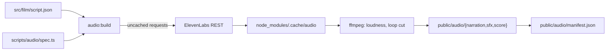

# Film audio

The film's narration, sound cues and score are generated with ElevenLabs by
`pnpm run audio:build` and committed under `public/audio/`. The film reads
them through `public/audio/manifest.json`. The narration words come from
`src/film/script.json`; everything else the build asks for is in
`scripts/audio/spec.ts`.

## Commands

| Command | Does |
| --- | --- |
| `pnpm run audio:build` | Build narration, sound cues and score, then write the manifest |
| `pnpm run audio:build -- --only narration` | Build some kinds (`narration`, `sfx`, `score`); the manifest keeps the others |
| `pnpm run audio:build -- --offline` | Use cached responses only; a cache miss fails |

The build needs `ffmpeg` and `ffprobe` with libopus, and `ELEVENLABS_API_KEY`
in the environment for any request it has not cached. The key is sent as a
header and never logged.

Every response is cached under the SHA-256 of its request, in
`node_modules/.cache/audio` (`AUDIO_CACHE_DIR` overrides). A rebuild with
unchanged inputs spends no credits and writes byte-identical files. To get a
new take of one sound, change its prompt, seed or settings. Deleting the cache
loses the takes: the next build generates new ones, which sound different.

## When to rebuild

- **A beat's words change in `script.json`.** Run `--only narration`. That
  beat and the beats stitched to it are generated again; the rest come from
  the cache.
- **A beat is added.** Add its id to the end of `SEED_ORDER` in `spec.ts`,
  then run `--only narration`. The build fails on a beat with no seed.
- **A chapter's `sfx` list names a new cue.** Add a prompt for it to `SFX` in
  `spec.ts`, then run `--only sfx`. The build fails on a cue with no prompt
  and skips prompts no chapter names.
- **The score or bed needs a new take.** Edit `SCORE` or `AMBIENCE` in
  `spec.ts`, then run `--only score`.

After a rebuild, check the narration by ear or with speech-to-text (see
[Checks](#checks)) before committing.

## Output

| Path | Contents |
| --- | --- |
| `narration/{beat}.webm`, `.m4a` | One file per beat, named by the beat id |
| `narration/{beat}.json` | Caption timing for that beat |
| `sfx/{cue}.webm`, `.m4a` | One file per cue id in the chapters' `sfx` lists |
| `score/score.webm`, `.m4a` | The underscore, about 105 s |
| `score/ambience-loop.webm`, `.m4a` | A 30 s bed that loops |
| `manifest.json` | One entry per sound |

Each sound has Opus in WebM (`file`) and AAC-LC in MP4 (`fallback`) for
browsers without WebM Opus. All are 48 kHz.

A manifest entry holds `id`, `kind` (`narration`, `sfx`, `score` or
`ambience`), `file`, `fallback`, `durationMs`, `loop`, `bytes` per format,
`loudness` (target and measured integrated LUFS, true peak in dBTP),
`licence` and `source`. `source` records the endpoint, model id, the prompt
or composition plan, the settings, the voice for narration and the
`character-cost` the API reported. Narration entries add `chapter`,
`text` (the spoken words, tags removed) and `captions`. Other entries add
`use`, where the film plays them.

A caption file holds `words`, each `{ text, startMs, endMs }` from the start
of the beat's audio, which is the shape of `CueWord` in
`src/film/captions.ts`. Word text keeps its punctuation, and audio tags are
dropped. `characters` keeps the raw character alignment: `text` is the
exact string sent, direction tag included, and `startMs[i]` and `endMs[i]`
time its `i`th character.

## Narration

| Setting | Value |
| --- | --- |
| Voice | Alice - Clear, Engaging Educator, `Xb7hH8MSUJpSbSDYk0k2` (ElevenLabs premade) |
| Model | `eleven_v4`, `POST /v1/text-to-speech/{voice_id}/with-timestamps` |
| Voice settings | stability 0.65, similarity 0.75 (v4 ignores style and speed) |
| Seed | 4101 plus the beat's place in `SEED_ORDER` (`spec.ts`) |
| Direction | `[calm, measured documentary narration]` before each beat's words |
| Language | `en` |
| Request format | `pcm_48000`, mono |
| Master | -16 LUFS integrated |
| Encoding | Opus 40 kbps mono; AAC 56 kbps mono |

**Casting.** The film needs a natural, warm British explainer that an
ordinary listener trusts: not a newsreader, and not a storyteller. Alice was
compared with the other three premade British voices on three beats
(`pour-1`, `split-2` and `swarm-4`). Each take used the same model, settings,
seed and stitching as the build.

| Voice | ElevenLabs labels | Outcome |
| --- | --- | --- |
| Alice - Clear, Engaging Educator | female, middle-aged, professional, informative and educational | Kept |
| Daniel - Steady Broadcaster | male, middle-aged, formal, informative and educational | Labelled formal: the newsreader read the film avoids |
| George - Warm, Captivating Storyteller | male, middle-aged, mature, narrative and story | Labelled for storytelling |
| Lily - Velvety Actress | female, middle-aged, confident, informative and educational | Labelled as an actor's voice |

On those beats the four voices read at the same pace, within 8% of each
other. Their pitch moves by the same amount: 11 to 15 semitones between the
10th and 90th percentile, measured with Praat. Every take transcribed word
for word. No voice measured as a more natural read, so a switch would buy
no measured change for a full re-record. Alice is the only one of the four
whose labels say she explains. The comparison is by labels, measurement and
transcript, not by ear.

Premade voices stay available, so later beats can be regenerated in the same
voice. Keep Alice for every beat so the film has one narrator.

**Direction.** `script.json` holds the words only. The build puts one v4 tag
before each beat. The tag names a voice quality, so the model does not render
it as a sound, and the words stay exactly as the script writes them. A beat
that carries its own tags is sent unchanged. `split-4`, which asks for the
reader's guess, and `landing-2`, the last line, carry `[calm, warm]`.
`swarm-4`, which says why each benefit is compared with its own age group,
carries `[calm, thoughtful]`. Keep tags this rare: the default direction holds
the read level. A `[warm, conversational]` direction was tried on Alice for
`pour-1` and `split-2` and changed little. `split-2` came out the same length
with the same pitch range, and `pour-1` 0.08 s shorter with 0.7 semitones more
range. The default direction stays.

**Seeds.** A beat's seed comes from its place in `SEED_ORDER`, not from its
place in the script, so a new beat goes at the end of that list and every
other beat keeps its request and its cached take. `RESEED` in `spec.ts` gives
a beat its own seed instead. `rain-3` and `pour-1` have one: their first
takes stopped before the last sound died away, which plays as a click.

**Stitching.** Each request sends the spoken words of the beats heard either
side as `previous_text` and `next_text`, so pace and pitch carry across
files. The two skyline beats play in a random order, so each is stitched to
the fixed beats around the pair. The beats next to the pair get no context
on that side. `skyline-working-age` is sent without `previous_text`: with it,
every seed tried opened on "Waking age". `NO_PREVIOUS_TEXT` in `spec.ts`
lists such beats. `swarm-1` is sent without `next_text`: with it, nine seeds
ran on towards the next sentence and came back cut off part way through
"resident". `skyline-4` is too: with it, two seeds came back cut off in
"other". `NO_NEXT_TEXT` lists such beats. Each manifest entry records the
beats it was stitched to in `source.settings.stitchedTo`. `STANDALONE` beats
are sent with no context and are skipped as context for the beats either
side. `split-4` is one: the film waits for the reader's guess after it, so
`split-3` and `wall-1` stay stitched to each other.

## Sound cues

Model `eleven_text_to_sound_v2`, `POST /v1/sound-generation`, requested as
`pcm_48000` and folded to mono. Every prompt ends "close, dry, quiet, no
music, no voices". Loop cues use the API's `loop` option.

| Cue | Use | Prompt (before the common ending) | Length | Loop | Influence |
| --- | --- | --- | --- | --- | --- |
| `pour` | The total breaks up into dots that gather in one pile | Fine brass grains pouring in a steady stream onto a soft pile, gentle granular hiss | 4 s | no | 0.5 |
| `settle` | The pile or the columns of dots come to rest | A small pile of fine grains settling and shifting briefly, then silence | 2 s | no | 0.5 |
| `tick` | A guess slider handle passes a step | One very soft wooden tick, like a quiet ruler detent, single short click | 0.6 s | no | 0.7 |
| `lock` | The reader locks a guess | A single soft mechanical latch click, small brass catch closing | 1 s | no | 0.7 |
| `reveal` | The real split appears beside the guess | A gentle soft swell of air ending in a faint low bell tone, subtle and calm | 2.5 s | no | 0.5 |
| `stack-loop` | The dots stack into one column for each benefit | Continuous dense soft clicking of small wooden tokens placed one after another in neat rows, steady even rhythm with no gaps | 4 s | yes | 0.7 |
| `pan` | The camera pans along the columns | A slow, very soft airy whoosh passing by, smooth and even | 2.5 s | no | 0.5 |
| `rain` | The dots move to their constituencies on the map | Light patter of fine grains falling onto a wooden table, scattered and soft | 4 s | no | 0.5 |
| `rise` | Each constituency rises to its height on the 3D map | A soft rising tonal whoosh, gentle upward movement, smooth | 1.5 s | no | 0.5 |
| `morph` | The map switches between real and equal-size shapes, or turns into a chart of dots | A smooth soft airy transition sweep with a faint shimmer, subtle | 2 s | no | 0.5 |
| `tilt` | The camera tilts to show the 3D map | A deep, soft, slow whoosh of a camera moving through still air | 2 s | no | 0.5 |
| `land` | The map moves to the reader's area | A soft low thud of a small object landing on felt, damped | 1 s | no | 0.6 |
| `open` | The black bars slide away to open the explorer | A smooth soft mechanical slide of a panel opening, quiet and even | 1.5 s | no | 0.6 |

Cues master to -18 LUFS and encode as Opus 48 kbps and AAC 64 kbps, mono.

## Score

Model `music_v2_5`, `POST /v1/music`, requested as `mp3_48000_320`. The
score must not tell the reader how to feel about a number. It stays curious
and even, never ominous or triumphant.

The score is one composition plan of four sections. Every section's `text`
is empty, because the model sings any text it is given. Each section's
direction is in its `positive_styles`. Every section's `negative_styles`
excludes vocals, singing, choir, spoken word, drum kit, electronic beat, EDM,
epic trailer, braams, aggressive, ominous, triumphant fanfare and synth lead.

| Section | Length | Styles |
| --- | --- | --- |
| Opening | 22 s | understated documentary score, solo felt piano, sparse sustained notes, warm low string pad, slow tempo 68 bpm, contemplative and curious, intimate close-miked recording |
| Pulse | 26 s | gentle pizzicato cello pulse, felt piano figures, soft ticking rhythm, measured forward motion, curious |
| Lift | 30 s | strings swell gently, fuller warm arrangement, open and expansive, rising harmony, restrained lift, soft timpani roll |
| Resolve | 27 s | return to solo felt piano, settled major chord, gentle resolution, slow fade out, ends on a held chord |

Measured in 5 s windows, the take is quiet through the opening and pulse
(about -27 to -39 dBFS RMS), fullest from about 55 s to 90 s (about -22 to
-25) and fades to silence over the last 10 s.

The ambience bed is a prompt-mode request with `force_instrumental`: "Ambient
underscore bed: soft sustained warm analogue pad in a low register, very slow
movement, no melody, no rhythm, no percussion, steady level, calm and
neutral, documentary room tone". It is generated at 48 s. The loop is cut
from 8 s to 42 s, clear of the model's intro and fade-out, and its last 4 s
cross-fade into its first. The result is a 30 s loop at an even level.

Both master to -22 LUFS. The score encodes as Opus 64 kbps and AAC 96 kbps,
stereo. The bed encodes as Opus 48 kbps and AAC 80 kbps, stereo.

## Loudness

Each sound is resampled to 48 kHz and downmixed first, then measured with
ffmpeg's EBU R128 meter. Wide stereo folded to mono loses 3 to 6 dB, so
measuring first would aim wrong. One linear gain moves it towards the target,
then a limiter holds true peaks near -2.5 dBTP at 4x oversampling. A second
pass adds back what the limiter took. Linear gain keeps loops seamless.

A transient cue cannot reach its target without crushing its attack, so the
limiter takes at most 9 dB. `lock` (-30 LUFS), `stack-loop` (-27), `rain`
(-25.5), `land` (-23.4) and `tick` (-21.5) stay below -18. Clicks with short
peaks still sound present at those readings. Narration measures -16.2 to
-16.7 LUFS after encoding. The manifest records each sound's measured
loudness. Every file measures -0.2 dBTP or below.

## Payload

| Kind | Opus WebM | AAC MP4 |
| --- | --- | --- |
| Narration, 24 beats, 145.1 s | 782 kB | 1,075 kB |
| Sound cues, 13 | 190 kB | 250 kB |
| Score and bed | 1,101 kB | 1,594 kB |
| **Total** | **2,072 kB** | **2,919 kB** |

A browser fetches one format. Caption files and the manifest add 110 kB.
Narration is one file per beat, so the film can fetch a chapter's beats as
the reader reaches it.

## Playback notes

- Opus and AAC add encoder padding, so `durationMs` runs about 8 ms over the
  requested length. An `<audio loop>` element leaves a small gap at the
  seam. For a gapless loop, play `stack-loop` and `ambience-loop` through Web
  Audio: `decodeAudioData` trims the padding, and `AudioBufferSourceNode.loop`
  repeats the buffer exactly.
- Caption times are measured from the start of each beat's file, so they hold
  for both formats.

## Checks

Every narration file was transcribed with ElevenLabs speech-to-text
(`scribe_v2`) and compared with its beat. All 24 match the script apart from
how the transcript writes numbers and its American spelling of "colour". No
tag was spoken. The voice reads "2024-25" as "twenty twenty-four to
twenty-five". The transcript of `wall-2` gives "one hundred thirty-eight"
billion pounds, without the British "and". `split-3` says "make your guess":
the take of "set your guess" was transcribed as "set your gas". The score and
the bed were transcribed too: neither has a voice.

Every narration file also ends in silence. The last 10 ms of each decoded
file is at least 45 dB below its peak. A take that the API cut off fails this
and plays as a click, so it is taken again (see `RESEED` and `NO_NEXT_TEXT`).

## Costs

The API reports a `character-cost` header for speech and sound effects.
`audio:build` prints the credits its new requests cost.

## Licence

Generated with ElevenLabs on a paid plan and used under the ElevenLabs Terms
of Service. Each manifest entry states this in `licence` and records its
request in `source`. The repository's [LICENSE](../../LICENSE) sets out the
audio's terms apart from the code's.
