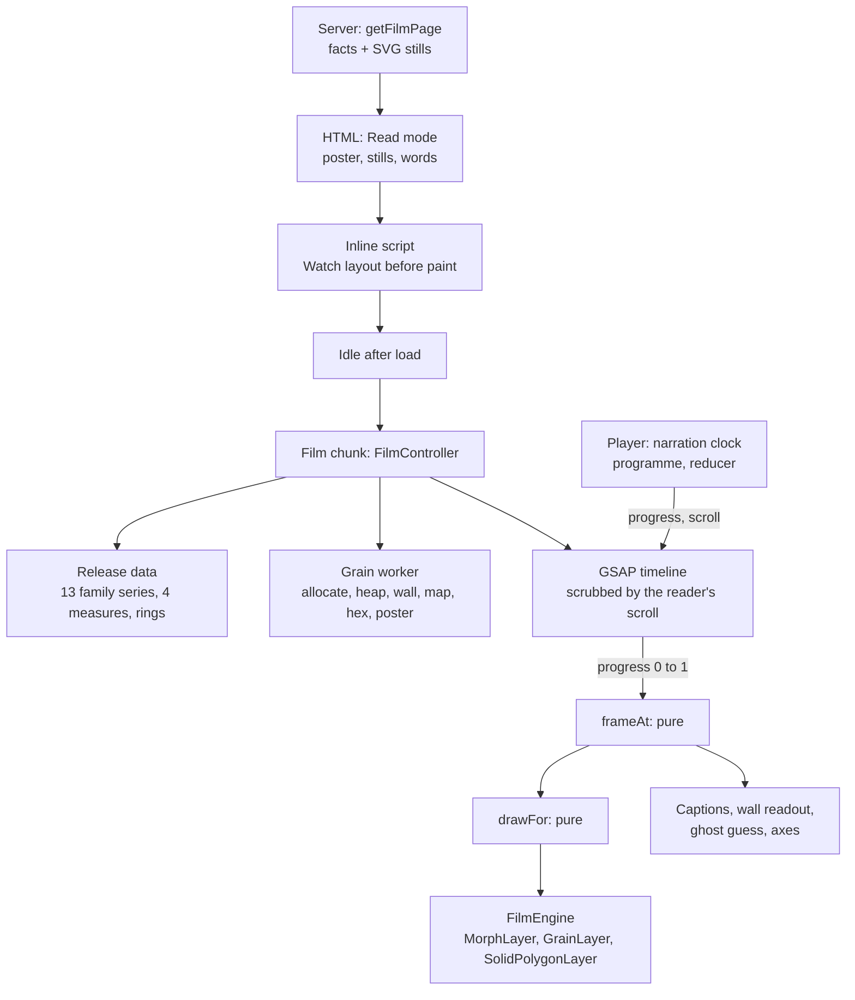
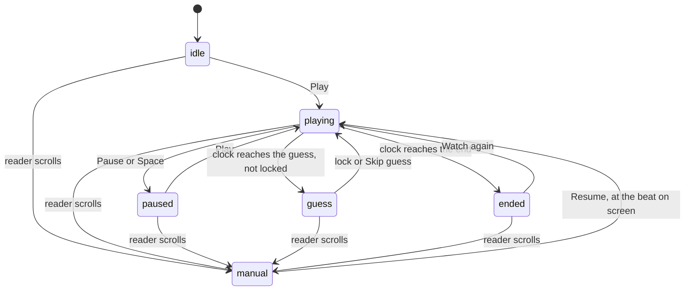

# Film engineering

How the film on the home page (`/`), "Where benefit money goes", is built, and what
it measured. `/film` redirects to `/` with its parameters. The words are
in [`src/film/script.json`](../../src/film/script.json); the sound is in
[audio.md](audio.md). Rendering follows
[ADR 0003](../adr/0003-one-deckgl-canvas-and-one-gsap-clock.md) and
[ADR 0008](../adr/0008-draw-the-explorer-with-deckgl-alone.md): one deck.gl
canvas with no basemap library, one GSAP clock.

## Shape

| Module | Job |
| --- | --- |
| `src/film/script.json`, `script.ts` | Chapters, beats, groups; each narrated figure names a check |
| `data.ts`, `figures.ts`, `facts.ts` | Release reads through `SiteData`; every number the film states |
| `grains/allocate.ts` | Grains per family, shared between areas by largest remainder |
| `grains/scenes.ts` | Heap, wall, map, hex and poster positions, 16-bit unit frames |
| `grains/worker.ts`, `messages.ts` | Builds scenes off the main thread and streams them |
| `timeline.ts` | Chapter spans, `frameAt(progress)`: one scene function per chapter |
| `stage.ts` | Scene rectangles for a stage size, `drawFor(frame)` |
| `captions.ts`, `audio.ts` | Caption cues and their clock knots; Web Audio, with narration scheduled on the context clock |
| `programme.ts` | Every beat on one film clock, and the progress at each millisecond |
| `playback.ts` | The player's states and moves: a pure reducer |
| `player.ts`, `PlayerBar.tsx`, `stills-surface.ts` | Playback: the clock, the takeover listeners, the controls, Read mode's stepped stills |
| `controller.ts`, `FilmStage.tsx` | Watch mode: timeline, worker, overlays, landing; the player's surface |
| `Film.tsx`, `GuessTape.tsx`, `PostcodeLanding.tsx`, `stills.tsx` | The page, in both modes |
| `src/viz/engine/grain-layer.ts` | Instanced grains, mixing two scenes on the GPU |
| `src/viz/engine/film-engine.ts` | The film's canvas; draws exactly the frame it is handed |
| `src/viz/layout/beeswarm.ts` | Latitude and age swarms in the swarm bundle's shape |

## Determinism

- **One number.** One paused GSAP timeline carries `progress` from 0 to 1
  over the reel. The reader's scroll scrubs it through ScrollTrigger (0.35 s
  catch-up); a playing film sets it directly and scrolls the page to match. `frameAt` is a pure function of it, so a
  frame is the same scrolling down or up; a test runs 401 frames both ways
  and compares them. The poster's SplitText dissolve sits on the same
  timeline.
- **Rest frames.** The last 0.3 viewport heights of each chapter hold still.
  Hash links (`#benefit-by-benefit`) land there; `CHAPTER_ANCHOR` in `script.ts` names each chapter's anchor. Each chapter's card stays pinned through its rest frame: the
  chapter runs 30svh under the next, with a matching negative margin.
- **Captions on the picture.** Progress drives the caption clock through
  knots (`clockKnots`), and `BEAT_STARTS` in `timeline.ts` starts each beat
  with the scene it describes: the age-swarm beat with the age swarm, each
  skyline beat with its skyline. Playback runs the same knots the other way,
  so a playing film captions the word the voice is saying.
- **Seeded grains.** Positions come from a seeded generator (Mulberry32 over
  an FNV-1a seed), so every load bakes the same buffers.
- **Pinned frames.** `?frame=0.43` scrolls to that progress once the canvas
  is ready, with no scrub smoothing. Screenshots and tests use it.
- **Reader inputs** re-render the current frame and never move the clock:
  the guess tints the heap by key thresholds, the shape chip tweens the area
  marks, and the grains resting on them, between the real map (the default)
  and equal-size hexes, and a postcode flies the camera (1.8 s,
  `power3.inOut`, retargets on a new postcode, returns home when the reader
  scrolls away).

## Playback

Play runs the film like a video. One tap is needed, since browsers start
sound only from a gesture; the audio context is made inside it.

- **The clock.** `programme.ts` lays each chapter's beats end to end (350 ms
  between beats), then a tail of 1.6 s carries the film through the rest
  frame into the next chapter; after the guess the tail is 3.2 s, so the
  reveal can be read. The whole film runs about 2 min 45 s. While playing,
  the audio context's time is the film clock: each frame reads it, maps it
  to progress and shows that frame. Without sound the clock is
  `performance.now()`.
- **Narration.** Beats are scheduled on the context clock 600 ms ahead, so
  voice and picture share one timeline. A beat not yet decoded when its time
  comes holds the clock for up to 4 s, so the picture never runs ahead of
  the words. The current and next chapters' beats are fetched ahead.
- **The guess.** The clock stops where `split-4` ends ("Now it's your turn")
  until the guess is locked or skipped, unless a locked guess already
  stands. Play from the poster or Watch again unlocks the stored guess, so
  each viewing asks again.
- **Takeover.** A wheel, a touch drag outside the guess tape, a scroll key or
  a scrollbar drag (the page more than 8 px from where the player put it)
  hands the film to the reader. The voice fades over 300 ms, the captions
  stay, and the bar shows Resume. Resume plays on from the start of the beat
  at the scroll position, or from the position itself between beats.
- **Controls.** Play and pause, a line back and on, a progress bar with a
  tick per chapter, the chapter list, captions, mute and Explore. Space
  plays and pauses, unless a button or link has focus; the left and right
  arrows step between lines.
- **Sound.** The score ducks under every beat and comes back after it; it
  drops out while paused. Cues play once the sound is on. Mute silences
  everything and lasts for the session (`sessionStorage`); the captions
  choice lasts on the device (`localStorage`).
- **Read mode.** With reduced motion, `?mode=read` or no WebGL2, Play cuts
  to each chapter's still and words as its narration starts, with no
  scrolling motion, and the bar carries the caption.
- **Returning viewers.** Playing the film sets `wgw-film-seen` in
  `localStorage`. A script before first paint then swaps the poster's Play
  and Skip to the explorer for Watch again and Go to explorer.

## Grains

| Tier | Grain | Grains | Wall columns | Bytes per scene | Build in Node (M5) |
| --- | --- | --- | --- | --- | --- |
| light | £10m | 29,899 | 324 | 120 kB | 21 ms in all |
| full | £1m | 298,996 | 3,014 | 1.2 MB | 159 ms in all (heap 135 ms) |

- **Tier.** `tier.ts` gives £1m grains only to a desktop with a named
  capable GPU (Apple M, NVIDIA, AMD, Intel Iris Xe or Arc), 8 GB or more and
  8 cores or more; phones, software renderers, Save-Data and hidden renderer
  strings get £10m. `?grain=1m` or `?grain=10m` overrides it. The key in the
  stage corner always states the grain size.
- **Counts.** Each family gets round(total / unit) grains, shared by largest
  remainder, so families add up exactly and each area is within one grain
  per family of its exact share. A test checks group shares against the
  release to 0.1 points.
- **Buffers.** A scene is `Uint16Array` [x, y] per grain in a unit frame;
  the shader maps each frame to a pixel rectangle, so a resize moves
  rectangles and rebuilds nothing but the poster mask. Keys (`unorm16`) set
  each grain's delay and guess layer; colours are per grain.
- **Streaming.** The worker sends the grain set, then heap, wall, map and
  hex in the order the film reaches them; the poster mask is sampled from the
  figure as drawn, after fonts load. GPU buffers upload once per scene and
  swap by reference.
- **Land.** The rain puts grains onto the reader's shape: the
  `map` scene puts each grain inside its constituency's boundary ring, in
  the unit frame of the rings' bounds, so the shader maps it onto the map
  with one rectangle; `hex` puts it inside its equal-size hexagon.
- **Skylines.** "Two skylines" extrudes each area's ring of the reader's
  shape: real land by default, prisms on equal-size hexes. The frame rates
  below were measured with hexagonal columns, before this.
- **Wall.** Columns of 100 grains, a gap between families and a wider one
  between groups, on whole-pixel cells so the wall does not shimmer against
  the pixel grid.

## Modes

| Reader | Gets |
| --- | --- |
| Default, WebGL2 | Watch: pinned stage, grains, captions |
| `?mode=read` | Read: stills and words, no WebGL |
| Reduced motion (OS or toggle) | Read, stills cross-fade in over 120 ms; Play steps through the stills with the voice |
| No WebGL2, or context lost | Read |
| No JavaScript | Read, server-rendered; the split hides in a disclosure |
| Phone | Watch with £10m grains, one sticky stage, the control bar in two rows |

The guess tape uses one native range input per group (arrows, Page Up and
Page Down, Home and End), plus two draggable cuts. The guess is stored in
`localStorage` only; a test checks that locking it sends no request.
Nothing plays until the viewer presses Play. Captions are
`aria-hidden` because every beat is also in the page as text, and the full
transcript is a disclosure at the end. In Watch mode that text is clipped
out of sight; when keyboard focus enters a chapter's still or words, they
open as a card above the captions.

The grain key names the grain's worth. Once the area marks show, a scale in
the top right names what their shade measures and, for a skyline, what its
height measures, with the year, the price basis and a lower-to-higher ramp
(ADR 0004, rule 2).

## Performance

The figures below were measured before the player, scrubbing by scroll.
Playback has not yet been measured on a real GPU.

Measured on 2026-10-06 against the built Worker (`vite preview`), 1440 x
900, CPU throttled 4x through CDP, in a fresh playwright-cli session on the
real GPU (ANGLE Metal, Apple M5). Each chapter is scrolled from its start to
its rest frame over 4 s at a steady speed. Script: `e2e/film-perf.spec.ts`
does the same in Playwright.

### £10m grains

| Chapter | Mean fps | p75 fps | Worst frame ms | LoAF over 50 ms | Longest LoAF ms |
| --- | --- | --- | --- | --- | --- |
| the-pour | 60 | 59.9 | 17 | 0 | 0 |
| your-split | 60 | 59.9 | 17 | 0 | 0 |
| the-wall | 60 | 59.9 | 17 | 0 | 0 |
| the-rain | 60 | 59.9 | 17 | 0 | 0 |
| two-skylines | 60 | 59.9 | 17 | 0 | 0 |
| north-south-or-age | 60 | 59.9 | 17 | 0 | 0 |
| the-landing | 60 | 59.9 | 17 | 0 | 0 |

Seven of ten fresh £10m runs had no long animation frame over 50 ms. The
first three runs of the day each had one or two of 75 to 121 ms entering
the rain and the skylines; they did not recur and are not yet attributed.

### £1m grains

| Chapter | Mean fps | p75 fps | Worst frame ms | LoAF over 50 ms | Longest LoAF ms |
| --- | --- | --- | --- | --- | --- |
| the-pour | 60 | 59.9 | 17 | 0 | 0 |
| your-split | 60 | 59.9 | 17 | 0 | 0 |
| the-wall | 54.5 | 59.9 | 33 | 0 | 0 |
| the-rain | 60 | 59.9 | 17 | 0 | 0 |
| two-skylines | 60 | 59.9 | 17 | 0 | 0 |
| north-south-or-age | 60 | 59.9 | 17 | 0 | 0 |
| the-landing | 60 | 59.9 | 17 | 0 | 0 |

The wall at £1m is fill-bound: 300,000 discs of about 4 px. Before shaders
were warmed, a fresh session had a 113 ms frame entering the skylines and
54 ms entering the rain; the engine now draws transparent stand-ins for
every layer on its first frame.

### Software GPU and loading

Playwright's headless shell renders WebGL with SwiftShader: the grain
chapters run at 2 to 4 fps at £10m and under 1 fps at £1m there, and the
area-mark chapters at 21 to 44 fps. `tier.ts` sends software renderers the
light tier.

Loading, the same day, at 412 px with 150 ms latency, 1.6 Mbit/s and 4x
CPU, served by `vite preview` without compression:

| Page | LCP | LCP element | CLS |
| --- | --- | --- | --- |
| `/film` | 3.49 to 3.53 s | the poster figure | 0 |
| `/area/constituency/E14001063-aldershot` | 3.25 s | | 0 |
| `/explore` | 4.04 s | the Flip headline | 0.001 |

Workers serve these gzipped; the area page measured 0.84 s that way
([architecture](../architecture.md#performance)). The film's HTML is 217 kB
raw and 34 kB gzip. Before the inline Watch switch, CLS was 0.879, and the
film-grain background image was the LCP element.

JavaScript, gzip level 6:

| Part | Size |
| --- | --- |
| `/film` route beyond the main chunk (its loader stub and component chunk), before the player | 26.6 kB |
| Film chunk beyond the route (deck.gl, luma.gl, GSAP and plugins, contract parsers, film code), loaded when idle | 293.5 kB |
| Grain worker | 2.3 kB |
| Film CSS | 3.2 kB |
| Main chunk, with the film at `/` and the player | 115.2 kB |

`scripts/size.ts` has no film budget yet.

## Checks

| Layer | What it proves |
| --- | --- |
| `script.test.ts` | No banned word or long dash in any copy; every narrated figure matches the pulled release; every beat has a committed recording of its exact words, and every cue a sound |
| `grains/grains.test.ts` | Exact apportionment, wall order, determinism; heap fills bottom first by key; grains land inside their own hexagon where `hexLayout` draws it; poster grains start on inked pixels |
| `film.test.ts` | Spans, `frameAt` reversibility and rest frames, continuity across chapters, skyline order; caption timing, and beats starting on the scenes they describe; guess maths and storage; tiers; postcode parsing |
| `playback.test.ts` | The programme maps clock to progress and back, captions each beat on the frame scroll would, waits at `split-4`; every player move, takeover from each state, and Resume at the beat on screen |
| `stage.test.ts` | Scene rectangles, wall pan, skyline wipe, `drawFor`; audio manifest and worker message parsing |
| `src/viz/layout/beeswarm.test.ts` | No overlap, values on the axis, determinism |
| `e2e/film.spec.ts` | Server Read mode without JavaScript; Watch draws; Play scrolls the film under the narration; the guess pause, lock and Skip guess; wheel takeover and Resume; Space and the arrows; reduced motion steps through stills; Read without WebGL; `?mode=read`; skip link; returning viewer; keyboard guess stored locally; chapter hash opens ready to resume; `/film` redirects |
| `e2e/film-perf.spec.ts` (@perf) | Frame timing per chapter, both tiers |

## Not built

- The crowd ghost of other readers' guesses: it needs server storage, and
  the guess stays on the device.
- The "swap the categories" end card and a replay with opposite lenses.
- A shared canvas across the hand-off: `/explore` mounts its own engine,
  so the film flies home and navigates with a view transition.
- A `grains` bundle kind in the contract: buffers are baked in the browser
  from series the release already publishes, so the pipeline is unchanged.
