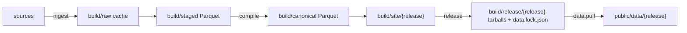

# Data pipeline

`wgw_pipeline` turns public benefit, population and tax statistics into the
site's data release. It is a uv project; every entry point is a pnpm script
([ADR 0005](../docs/adr/0005-python-pipeline-with-pnpm-entry-points.md)).

## Commands

Run from the repository root.

| Command | Does | Needs |
| --- | --- | --- |
| `pnpm run data:ingest` | Fetch every source into the raw cache, then stage it | network; `STAT_XPLORE_API_KEY` for uncached Stat-Xplore queries |
| `pnpm run data:compile` | Build the canonical tables and the release `build/site/{YYYY-MM-DD.N}` | staged data |
| `pnpm run data:test` | pytest: unit, contract and honesty tests | compiled output for the data tests; they skip without it |
| `pnpm run data:release` | Pack the newest compiled release and write `data.lock.json`; prints the `gh release create` command | a compiled release |
| `pnpm run data:pull -- --local` | Copy a compiled release into `public/data/` and check it against its manifest | a compiled release |
| `pnpm run data:pull` | Download the locked release over HTTPS, check its SHA-256, extract and check it | network, `data.lock.json` |

Useful flags, passed straight after the script name (pnpm 11 forwards a
literal `--` to argparse, which rejects it): `pnpm run data:ingest --offline`
(cache only), `--refresh` (refetch everything), `--only sss prices` (some
steps), `--seed-from DIR` (copy matching earlier downloads into the cache
first). `pnpm run data:compile --release 2026-10-06.2` sets the release id.
`pnpm run data:release --publish` runs the `gh` command; only the maintainer
does that, signed in to `gh`.

## Stat-Xplore key

`STAT_XPLORE_API_KEY` comes from the environment or a gitignored
`pipeline/.env` (see `pipeline/.env.example`). It is sent as the `APIKey`
header and is never logged. Do not put it in the repository root `.env`: the
Cloudflare Vite plugin loads that file into the Worker and copies it into
`dist/server/.dev.vars`. The pre-commit gitleaks step scans staged changes
only, so an ignored `pipeline/.env` does not block a commit. Cached queries
need no key. Queries run one at a time, back off for 60 seconds on HTTP 429
and halve a request that times out (HTTP 504).

## Raw cache

`build/raw/{source}/{key}/{YYYY-MM-DD}.{ext}` holds each download with a
`.meta.json` sidecar: URL, retrieval date, the publisher's file date
(`Last-Modified`) and SHA-256. Lookups return the newest retrieval; `--refresh`
adds a new dated file. `build/staged/retrievals.parquet` records what each run
used, and the catalogue's `published` dates come from it.

## Canonical tables

| Table | Grain |
| --- | --- |
| `dim_area` | level x code: name, slug, nation, region, hex, centroid, land area, mid-2024 population |
| `dim_benefit` | benefit code: family, administrator, nations, years, devolution year |
| `dim_period` | fiscal year: GDP deflator, CPI, factors to 2026-27 prices |
| `fact_spend_area` | level x code x fiscal year x benefit, nominal pounds, flags, method, source |
| `fact_caseload_area` | level x code x month x benefit: claimants, mean weekly award, flags |
| `fact_population` | level x code x mid-year: total and age bands |
| `fact_tax_area` | level x code x fiscal year: income tax, taxpayers, flags |
| `fact_context` | level x code x indicator: deprivation decile and average rank, median annual pay |
| `bridge_area_overlap` | constituency x council: shared population and each side's share |
| `dim_representation` | constituency: current MP and party |
| `fact_election_2024` | constituency x candidacy at the 4 July 2024 general election: party as text, votes, electorate, majority |
| `fact_pip_condition` | level x code x condition group at the latest PIP month, England and Wales areas and countries: claimants, flags |

Rules applied, from the source notes below and
[ADR 0004](../docs/adr/0004-neutrality-and-honesty-rules.md):

- Totals are rebuilt from family members; the published TOTAL is never used.
- Constituencies are 2024 boundaries only; 2010-boundary rows are never read.
- Local authority history is re-keyed to April 2023 councils: recodes are
  aliases, and merged districts are summed (`canonical/la_codes.py`).
- Ratios pair the same fiscal year; fiscal-year values divide by the mid-year
  population at the start of the year; caseload rates use mid-2024.
- Carer and Universal Credit claimant counts hold people aged 16 to 64 only
  (`CA_16_64`, `CSP_16_64`, `UC_16_64`), in every denominator. Scottish
  councils use Scotland's Carer Support Payment age share, flagged modelled.
- Orkney and Shetland State Pension (2023-24, 2024-25) is flagged partial
  coverage; area Winter Fuel Payment 2022-23 and 2023-24 (Cost of Living
  top-up) is flagged as a series break.
- Abroad and unknown rows stay in DWP's GB totals and in no area.
- Ranks leave out small-population, partial-coverage and suppressed values.
- A GB value is one GB numerator over one GB population band, both summed
  over councils, and every level publishes it unchanged
  (`compile/values.py`). Constituency sums differ by under 1%.

## Source notes

Stat-Xplore (`https://stat-xplore.dwp.gov.uk/webapi/rest/v1`) truncates
`/schema/<id>` at 100 children, so value ids are built rather than listed:
`str:value:<DB>:<TABLE>:<FIELD>:<VALUESET>:<CODE>`. A mean needs
`str:statfn:<DB>:<TABLE>:<MEASURE>:MEAN`; without it a measure sums. Large
tables are split by period, since a query times out after about 60 seconds.

Known problems in the published sources, each handled in ingest:

- The published local authority TOTAL is wrong in some years (2020-21 leaves
  out Universal Credit), so totals are always rebuilt from benefits.
- Some year sheets carry errors: Pension Credit 2005-06 by council is about a
  sixth of the right value, and 2021-22 council names are corrupted, so rows
  join on GSS code, never on name.
- Scotland leaves the DWP spend tables and Stat-Xplore at different dates.
  Spend: Carer's Allowance from 2019-20, DLA, PIP and Attendance Allowance
  from 2020-21, Winter Fuel Payment from 2024-25. Stat-Xplore still counts
  some Scottish cases for years after.
- Orkney and Shetland State Pension spend is understated by about a third in
  2023-24 and 2024-25, because Shetland was coded "Unknown" from August 2023
  to August 2024.
- Area Winter Fuel Payment figures for 2022-23 and 2023-24 include the
  pensioner Cost of Living top-up, and the area method changed in 2020-21.
- Joining 2010 and 2024 constituencies by name makes false jumps, so the site
  uses 2024 boundaries only.
- State Pension claimants per person aged 66 and over exceed 1 in most
  constituencies, because March 2026 admin counts meet mid-2024 population.
- Universal Credit counts come in three units (a year average, households and
  people). The site never mixes them in one figure.
- About £5.6bn of State Pension paid abroad is in GB totals but in no area.
- HMRC income tax by council for 2010-11 to 2016-17 needs an alias map for
  renamed councils, and some constituency cells are suppressed.

## Scotland

Devolved families combine Social Security Scotland payments with modelled
payments DWP made for the Scottish Government during case transfer; council
figures reach constituencies by 2022 census population. See
[ADR 0006](../docs/adr/0006-estimate-scottish-devolved-spending.md). Scottish
caseloads for devolved benefits are Social Security Scotland counts only.

PIP by main disabling condition leaves Scotland out: DWP's Scottish PIP cases
are the few still to move to Adult Disability Payment, and Social Security
Scotland publishes Adult Disability Payment conditions for Scotland only, not
by area. Scottish dossiers carry the `pip-conditions-scotland` caveat, and the
comparison for other areas is England and Wales.

## Tests

`tests/` holds unit tests (bundle encoding against
`contract/fixtures/series-mini.bin.hex`, layouts, area codes, cache), contract
tests (every compiled JSON file against `contract/schema`, bundle headers,
manifest hashes, area order hash) and honesty tests (reconciliation with DWP
outturn, Scottish harmonisation, denominators, same-year ratios, ranks, banned
words).
